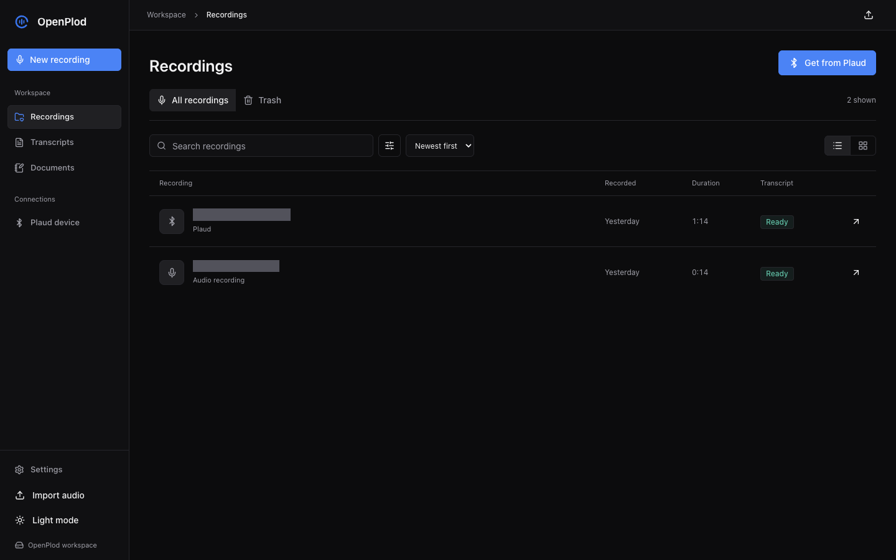

<p align="center">
  
</p>

<h1 align="center">OpenPlod</h1>
<p align="center"><strong>Local-first Plaud Note Pro recording vault, transcription, and Markdown workspace.</strong></p>
<p align="center">Import over Bluetooth. Keep your original audio. Turn recordings into documents and source-linked AI conversations.</p>
<p align="center">
  <a href="https://github.com/RemiPelloux/OpenPlod/releases/latest"></a>
  <a href="https://github.com/RemiPelloux/OpenPlod/actions/workflows/ci.yml"></a>
  
  <a href="docs/mcp.md"></a>
  <a href="LICENSING.md"></a>
  <a href="https://github.com/sponsors/RemiPelloux"></a>
</p>
<p align="center">
  <a href="#download">Download</a> &middot;
  <a href="docs/getting-started.md">Get started</a> &middot;
  <a href="#get-recordings-from-plaud">Plaud</a> &middot;
  <a href="#android-companion">Android</a> &middot;
  <a href="docs/api.md">API</a> &middot;
  <a href="docs/mcp.md">MCP</a> &middot;
  <a href="ROADMAP.md">Roadmap</a> &middot;
  <a href="CHANGELOG.md">Changelog</a>
</p>

OpenPlod is a desktop app for macOS, Linux, and Windows that keeps your recordings in a local
vault, transcribes them with the provider you choose (or fully locally), and turns transcripts into
Markdown documents. An Android companion pairs over your private network and can pull audio
straight from an enrolled Note Pro.



> [!IMPORTANT]
> **Plaud extraction needs an authorized device.** Direct Bluetooth download is verified on one
> Plaud Note Pro, and the recorder refuses audio until this computer holds a Plaud-minted identity
> ([device authorization](#device-authorization)). Everything else (vault, microphone, file imports,
> transcription, documents, automation, backups) works without one. Live-provider, Android-phone,
> and signing checks that only an owner can run are listed in the [roadmap status](ROADMAP.md#100-status).

## Features

- **Audio vault.** Bluetooth import from Plaud, microphone capture, file imports, and phone
  transfers. Originals are kept with fingerprints and provenance; Trash keeps items for 30 days.
- **Transcription.** Mistral Voxtral, local whisper.cpp, Deepgram, OpenAI, and AssemblyAI, with
  fallback order, spending limits, and automatic splitting of long recordings.
  **Transcription profiles** add a context prompt and vocabulary for each kind of recording.
- **Transcript Studio.** Speaker and segment editing, word-level version diffs, AI cleanup you
  review before saving, chapters, decisions and action items, subtitles, and PDF export.
- **Documents.** Generate notes, minutes, briefs and more from a transcript, review the Markdown,
  and save it with links back to the source. Folders, tags, saved views, backlinks, and history.
- **AI chat over your recordings.** Answers cite exact quotes with timestamps and transcript
  versions. Hybrid search with local embeddings.
- **Automation.** Signed webhooks, opt-in rules ("Plaud meeting → transcribe → minutes → folder"),
  task exports to Todoist, Linear, Notion, or calendar files, and one-way Obsidian export.
- **Safety.** Crash-safe imports, encrypted full-vault backups with a restore wizard, secrets
  encrypted at rest, and **Local only** mode that blocks every cloud call.
- **Integrations.** A versioned [REST API](docs/api.md) and a [read-only-by-default MCP server](docs/mcp.md).
- **English and French** interface, light and dark themes, keyboard navigation, ⌘K command palette.

**New in 1.1.0:** faster list endpoints and mobile sync (a fixed number of queries per page),
webhook history pruned after 90 days, search no longer waits on a stopped Ollama, settings save in
one transaction, and updated dependencies. See the [changelog](CHANGELOG.md#110---2026-11-15).

## Download

Get the installers from the **[latest release](https://github.com/RemiPelloux/OpenPlod/releases/latest)**.

| Platform | Package | Notes |
| --- | --- | --- |
| macOS Apple Silicon | `.dmg` | Ad-hoc signed, not notarized: approve it in Privacy & Security. |
| Windows x64 | `.exe` or `.msi` | Unsigned. Bluetooth extraction not verified on Windows hardware. |
| Linux x64 | `.deb` or `.rpm` | Declares BlueZ, D-Bus, and ffmpeg dependencies. |
| Android ARM64 | [Build it](#android-companion) | No public APK; sign with your own keystore. |

Verify downloads with `SHA256SUMS.txt` from the same release:
`shasum -a 256 -c SHA256SUMS.txt --ignore-missing`.

**Upgrading:** quit OpenPlod, back up the vault, and replace only the app. Never delete the vault
directory. See [upgrade and migration](docs/upgrade-and-migration.md).

## Build From Source

You need [Bun](https://bun.sh), [Rust](https://rustup.rs), the
[Tauri prerequisites](https://v2.tauri.app/start/prerequisites/) for your platform, and `ffmpeg`
and `ffprobe` on the app's `PATH`.

### Build the Mac App

```bash
xcode-select --install && brew install ffmpeg
git clone https://github.com/RemiPelloux/OpenPlod.git && cd OpenPlod
bun install --frozen-lockfile && bun install --cwd web --frozen-lockfile
bun run install:mac --launch
```

The installer builds, verifies, and replaces `/Applications/OpenPlod.app`, archiving old copies in
`~/Library/Application Support/OpenPlod-install-archives/`. Grant Bluetooth access when asked.

### Build the Linux App

Also install `bluez` and `dbus`.

```bash
git clone https://github.com/RemiPelloux/OpenPlod.git && cd OpenPlod
bun install --frozen-lockfile && bun install --cwd web --frozen-lockfile
bun run tauri build --no-bundle
./src-tauri/target/release/openplod
```

The app runs its own Bun service on port **3487** and a Rust `plaud-bridge`
([`btleplug`](https://github.com/deviceplug/btleplug)) for Bluetooth on every desktop platform.

### Check Your Setup

```bash
bun run doctor          # what blocks Plaud transfer, with the fix for your platform
bun run doctor --json   # the same report, for bug reports
bun run device:scan     # look for an advertising recorder
```

The same report is in the **This computer** panel on the Plaud page.

## Get Recordings From Plaud

1. Authorize the Note Pro for this computer (see below).
2. Wake the recorder near your computer and disconnect other Bluetooth clients.
3. Open **Library** or **New Recording** → **Get from Plaud** → **Connect**.
4. Select recordings and **Import**, then play, transcribe, or export them.

Audio goes straight from the device over Bluetooth, never through Plaud's cloud. Each transfer is
checked (framing, size, decryption, Ogg integrity, playable duration), device bytes and decoded
audio are kept next to an M4A playback copy, and the recording stays on the Plaud. The extraction
commands exclude force-clear, ownership reset, and file deletion.

### Device Authorization

Bluetooth discovery does not grant access. The recorder needs a private identity file (binding
token, signed authorization, RSA key pair) with permissions `0600`:

```text
~/Library/Application Support/com.openplod.vault/plaud-device.json   # macOS
~/.local/share/com.openplod.vault/plaud-device.json                  # Linux
%APPDATA%/com.openplod.vault/plaud-device.json                       # Windows
```

Getting this identity is not yet an in-app flow; the verified test used the owner's existing
authorization. No identity, vendor secret, or SDK is distributed here. **Do not reset or rebind a
device** to work around authorization errors.

## Android Companion

1. With the desktop app open on a trusted network, scan the pairing QR code from **Settings**.
2. On the phone's **Plaud** tab, request authorization and approve the matching code on the desktop.
   The identity is encrypted to the phone and kept in Android Keystore.
3. Wake the Note Pro beside the phone and choose **Get from Plaud**. Extraction then works without
   the desktop online; the library, transcripts, and AI still use it.

Uploads to the desktop resume after interruptions and are checked with SHA-256 before the phone
lets go of its copy ([mobile sync](docs/mobile-sync.md)). To build, install JDK 17, Android SDK 36,
and the NDK, then:

```bash
bun run tauri android build --debug --target aarch64 --apk --ci
bun run check:android   # 16 KB alignment checks
```

## Transcription and AI

Pick speech and text providers separately in **Settings > AI providers**, or in the first-run
guide. Cloud fallback is off by default. **Local only** uses whisper.cpp and Ollama and blocks
every cloud request.

| Provider | Runs | Profile hints |
| --- | --- | --- |
| Mistral Voxtral | Cloud | None |
| whisper.cpp | Your computer | Prompt and vocabulary |
| OpenAI (`whisper-1`, `gpt-4o-transcribe`) | Cloud | Prompt and vocabulary |
| Deepgram (Nova-2, Nova-3) | Cloud | Vocabulary |
| AssemblyAI | Cloud | Vocabulary |
| Documents, summaries, chat | Mistral, OpenAI, Anthropic, Gemini, or local Ollama | — |

Hints a provider cannot take are skipped, shown before the job runs, and recorded in the
transcript's provenance. Cloud transcription sends audio; documents and chat send transcript text.
Setup and limits: [AI providers](docs/ai-providers.md), [privacy and cost](docs/provider-privacy-and-cost.md).

## API and MCP

The desktop service exposes an authenticated `/api/v1` ([REST API](docs/api.md)). The
[MCP server](docs/mcp.md) runs over local stdio and is read-only unless you set
`OPENPLOD_MCP_WRITE=1`; even then it has no purge, reset, or external-delivery tools.

```json
{
  "mcpServers": {
    "openplod": {
      "command": "/absolute/path/to/bun",
      "args": ["/absolute/path/to/OpenPlod/src/mcp/index.ts"],
      "env": { "OPENPLOD_URL": "http://127.0.0.1:3487" }
    }
  }
}
```

## Current Support

| Capability | Status |
| --- | --- |
| macOS desktop | Built and tested on Apple Silicon; Plaud download verified on hardware |
| Linux desktop | Runs on Arch (Hyprland); BLE discovery and connection verified over BlueZ |
| Windows desktop | Builds; Bluetooth extraction not verified on hardware |
| Android → Note Pro | Listing, download, and playback verified on one authorized Note Pro |
| Account-free first authorization | Not implemented |
| iOS | Not supported |
| Signed, notarized distribution | Needs signing keys; current builds are unsigned or ad-hoc signed |

Device details: [supported devices](docs/supported-devices.md).

## Data and Privacy

The vault lives in `com.openplod.vault` under your platform's app-data directory: the SQLite
database, `recordings/` (with `originals/`), the pairing token, and the device identity.

- **Back up the whole vault**, ideally with the built-in [encrypted backup](docs/backup-and-restore.md).
- **Recordings and the database are not encrypted by OpenPlod**; secrets are. Protect your OS
  account and disk.
- **Keep the service private.** It listens on the LAN for pairing, protected by a token but over
  plain HTTP. Do not expose it to the internet.
- **Trash is not secure erasure**, and deleting in OpenPlod never deletes from the Plaud.

## Development

React, TypeScript, Tailwind, and Radix UI in `web/`; Bun, Hono, Drizzle, and SQLite in `src/`;
Tauri and Rust in `src-tauri/`. Quit the native app, then:

```bash
bun run dev       # backend on http://127.0.0.1:3487
bun run dev:web   # UI on http://127.0.0.1:5173
bun run tauri:dev # or the native shell
```

Before a pull request:

```bash
bun test && bun run typecheck && bun run --cwd web lint && bun run build
```

Docker (`docker compose up --build`, port 3456) runs the web vault and file imports, without
Bluetooth. See [CONTRIBUTING.md](CONTRIBUTING.md) and [SECURITY.md](SECURITY.md).

## Troubleshooting

| Symptom | Check |
| --- | --- |
| Plaud is visible but recordings are unavailable | Presence is not authorization. Check the identity file, Bluetooth permission, and other connected clients. |
| Audio verification fails | `ffmpeg` and `ffprobe` must be on the app's `PATH`. |
| Phone cannot reach the vault | Keep the desktop app open, same private network, check the firewall, rescan the QR code. |
| App cannot reach its service | Something else is using port 3487, such as a dev backend. |
| Old-looking interface on macOS | Check **Settings > About OpenPlod**; reinstall with `bun run install:mac`. |

Run `bun run doctor --json` and include it, redacted, when you [open an issue](https://github.com/RemiPelloux/OpenPlod/issues).
Never attach device identities, private audio, or pairing QR codes.

## Sponsor and Support

OpenPlod is maintained by [Remi Pelloux](https://github.com/RemiPelloux).
[Sponsoring](https://github.com/sponsors/RemiPelloux) funds test devices, compatibility work, and
signed distribution. It does not buy a paid tier or support guarantees. Stars, bug reports, and
focused fixes help too.

## Credits and Licensing

Original OpenPlod work is [MIT](LICENSE); see [LICENSING.md](LICENSING.md) for scope and
[third-party notices](THIRD_PARTY_NOTICES.md). OpenPlod builds on
[jddavenportOpen/openplaud](https://github.com/jddavenportOpen/openplaud), whose history is
preserved. OpenPlod is independent and not affiliated with or endorsed by Plaud.
